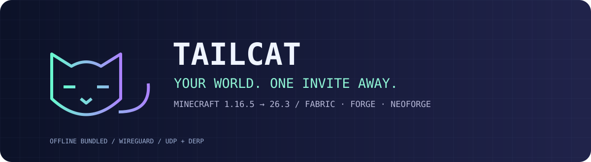

<div align="center">



# 🐈‍⬛ Tailcat Minecraft

**复制邀请，把你的世界接到朋友身边。**

[](docs/version-matrix.md)
[](docs/version-matrix.md)
[](https://github.com/Shirakawa-Kotone/tailcatWithMinecraft/releases/tag/v0.3.3)
[](LICENSE)

内置 [Tailcat](https://github.com/tailscale/tailcat)，无需额外安装网络程序或设置端口转发。
优先 UDP 直连，无法直连时自动通过 DERP 中继连接。

</div>

## 📥 下载与安装

**不知道选哪个？下载第一行的通用包。** 以下文件均支持下方列出的游戏版本和加载器，只需安装一个。

| 你的设备 | 处理器 | 下载 |
| --- | --- | --- |
| 不确定／跨平台整合包 | 全部支持的平台 | [全平台通用包](https://github.com/Shirakawa-Kotone/tailcatWithMinecraft/releases/download/v0.3.3/tailcat-universal-0.3.3.jar) |
| Windows 电脑 | Intel／AMD（x64） | [Windows x64](https://github.com/Shirakawa-Kotone/tailcatWithMinecraft/releases/download/v0.3.3/tailcat-universal-0.3.3-windows-amd64.jar) |
| Windows ARM 电脑 | ARM64 | [Windows ARM64](https://github.com/Shirakawa-Kotone/tailcatWithMinecraft/releases/download/v0.3.3/tailcat-universal-0.3.3-windows-arm64.jar) |
| Mac | Apple 芯片（M 系列） | [macOS Apple Silicon](https://github.com/Shirakawa-Kotone/tailcatWithMinecraft/releases/download/v0.3.3/tailcat-universal-0.3.3-darwin-arm64.jar) |
| Mac | Intel | [macOS Intel](https://github.com/Shirakawa-Kotone/tailcatWithMinecraft/releases/download/v0.3.3/tailcat-universal-0.3.3-darwin-amd64.jar) |
| Linux 电脑 | Intel／AMD（x64） | [Linux x64](https://github.com/Shirakawa-Kotone/tailcatWithMinecraft/releases/download/v0.3.3/tailcat-universal-0.3.3-linux-amd64.jar) |
| Linux ARM 设备 | ARM64 | [Linux ARM64](https://github.com/Shirakawa-Kotone/tailcatWithMinecraft/releases/download/v0.3.3/tailcat-universal-0.3.3-linux-arm64.jar) |

将选中的 JAR 放入游戏实例的 `mods` 文件夹，房主和朋友都需要安装。Fabric 还需安装与游戏版本匹配的 Fabric API。

单平台包需匹配游戏所用 Java 的架构；不确定时选择通用包。

通用包约 **19 MB**；单平台包约 **7 MB**。[全部版本与更新记录 →](https://github.com/Shirakawa-Kotone/tailcatWithMinecraft/releases)

> 当前为测试版。实机验证进展见[验证记录](docs/validation.md)。

## 🎮 开始联机

1. **房主**：进入单人世界 → 暂停菜单 → **Tailcat 分享** → **开始分享** → 复制短邀请码。
2. **朋友**：多人游戏 → **Tailcat 加入** → 粘贴邀请。
3. **返回游戏**：点击返回，分享会继续。**结束联机**时点击停止分享，或退出世界。

邀请仅分享给一起玩的朋友。双方的游戏版本和整合包仍需兼容。

## 🧩 支持版本

支持 **Fabric、Forge、NeoForge**，覆盖下列 15 个版本、38 个组合：

| 游戏版本 | Fabric | Forge | NeoForge |
| --- | :---: | :---: | :---: |
| 1.16.5、1.17.1、1.18.2、1.19.2、1.19.4 | ✓ | ✓ | — |
| 1.20.1、1.20.4、1.20.6 | ✓ | ✓ | ✓ |
| 1.21.1、1.21.4、1.21.11 | ✓ | ✓ | ✓ |
| 1.21.6 | ✓ | — | — |
| 26.1.2、26.2、26.3 | ✓ | ✓ | ✓ |

版本号需精确匹配；`—` 表示尚未提供该组合。[详细矩阵 →](docs/version-matrix.md)

## 📡 连接状态与测速

| 命令 | 用途 |
| --- | --- |
| `/tc-status` | 查看直连／中继、延迟、收发速率、会话峰值与版本信息 |
| `/tc-speedtest` | 测试当前直连会话的上下行速度 |

## 🛠️ 自行构建

```sh
./scripts/package.sh
```

本机编译、校验后输出到 `dist/`，成功后自动清理项目缓存。[环境准备与构建说明 →](docs/building.md)

## 📜 许可与致谢

采用 [BSD-3-Clause](LICENSE)。基于 [tailscale/tailcat-for-minecraft](https://github.com/tailscale/tailcat-for-minecraft) 扩展，使用 [tailscale/tailcat](https://github.com/tailscale/tailcat)，独立维护。第三方许可证随包分发。
